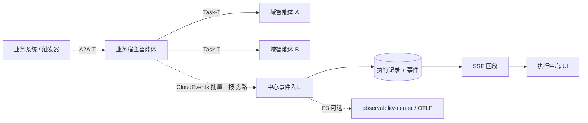

<!--
Copyright (c) 2026 Huawei Technologies Co., Ltd.
All Rights Reserved.

SPDX-License-Identifier: Apache-2.0

   Licensed under the Apache License, Version 2.0 (the "License"); you may
   not use this file except in compliance with the License. You may obtain
   a copy of the License at

        http://www.apache.org/licenses/LICENSE-2.0

   Unless required by applicable law or agreed to in writing, software
   distributed under the License is distributed on an "AS IS" BASIS, WITHOUT
   WARRANTIES OR CONDITIONS OF ANY KIND, either express or implied. See the
   License for the specific language governing permissions and limitations
   under the License.
-->

# 执行过程观察：整体方案

> 历史设计。接收状态码、事件类型、终态补发、批次限制、游标和部署配置，以随代码发布的 [PSOP 执行结果上报](psop-execution-reporting.md) 为准。

**状态:** Proposed。配套：[宿主与编排中心的职责边界](host-center-boundary.md)。

**目标:** 调度逻辑与 Java SDK 完全一致（业务宿主自己检索、自己派发、自己持有结果），同时让执行过程在编排中心实时可见。上报接口采用**已有的公开标准**，不发明私有协议。

## 0. 摘要与三个决定

| # | 决定 | 理由 |
|---|---|---|
| D1 | 执行过程以**事件流**上报，接口用 **CloudEvents 1.0**（HTTP structured batch） | 与现有 SDK 事件模型 1:1，实时性好，跨语言实现成本低 |
| D2 | 关联用 **W3C Trace Context**（`traceparent` / `tracestate` 作为 CloudEvents 扩展属性） | 不引入新协议就把一次执行串成链路，日后可直接接 OTel |
| D3 | 长期可观测走 **OTLP 导出**（可选，P3），不作为上报主接口 | span 必须结束后才能导出，与“步骤开始就要可见”冲突 |

编排中心由“调度者”退为“观察者”：不再下发 PSOP 快照、不再持有执行发起权，只接收事件、存储、回放。

## 1. 需求与约束

| 编号 | 需求 | 约束 |
|---|---|---|
| R1 | 业务系统直连宿主，宿主自主检索与派发 | 与 Java SDK 行为一致 |
| R2 | 执行中心实时看到步骤、子任务、产物 | 秒级延迟即可 |
| R3 | 断线、重启、中心不可用不影响业务 | 上报是旁路，失败可补偿 |
| R4 | 记录可审计、可回放、可关联到一次业务请求 | 需要 execution_id 与 trace_id |
| R5 | 任何语言的宿主都能接 | 用公开标准，不强制安装我们的 SDK |

## 2. 标准选型

| 候选 | 标准性 | 实时性 | 与本项目事件模型契合度 | 跨语言成本 | 结论 |
|---|---|---|---|---|---|
| **CloudEvents 1.0** | CNCF 项目，规范 1.0 稳定，HTTP binding 与 batch 模式均已标准化 | 事件产生即发送 | 1:1（`type` + `data` 直接映射） | 低（JSON，无运行时依赖） | **选定** |
| OpenTelemetry / OTLP | CNCF，生态最完整 | 差：span 结束才导出 | 需把事件投影成 span | 中（官方 SDK） | P3 作为分析/导出通道 |
| A2A `tasks/resubscribe` | A2A 协议原生 | 好 | 只有宿主自身任务流，拿不到历史 | 低 | 不选（见 §12） |
| 自定义 REST | 无 | 好 | 好 | 低 | 不选（用户明确要求标准） |

**为什么不用 OTLP 做主接口：** OTel 的 span 是不可变的、结束后才进 exporter 队列。一次 30 秒的步骤在 OTel 里要么等它结束才可见，要么用“零时长事件 span”模拟，等于把事件流硬塞进 trace 模型。CloudEvents 本身就是“事件信封”，与我们的 `EventType` 完全同构；需要链路分析时，再用 `traceparent` 把同一批事件映射成 OTel，两边不冲突。

## 3. 总体结构



上报是旁路：不阻塞派发，失败进本地队列重试，中心不可用时业务照常完成。

## 4. 事件模型与语义约定

### 4.1 CloudEvents 属性

| 属性 | 取值 | 说明 |
|---|---|---|
| `specversion` | `1.0` | 固定 |
| `id` | UUID | 全局唯一，去重键 |
| `source` | `urn:openan:agent:<host-agent-name>` | 上报方身份，须与凭证绑定一致 |
| `type` | `dev.openan.workflow.<阶段>.<动作>.v1` | 见 4.2 |
| `subject` | `execution_id` | 一次执行，聚合键 |
| `time` | RFC3339 | 宿主侧事件时间 |
| `datacontenttype` | `application/json` | |
| `dataschema` | 可选 | 指向事件 JSON Schema |
| `traceparent` | W3C 格式 | 关联链路（扩展属性） |
| `seq` | 字符串整数 | 单次执行内单调递增（扩展属性） |

### 4.2 类型映射

SDK 的 `EventType` 与 CloudEvents `type` 一一对应：前缀 `dev.openan.workflow.`，后缀 `.v1`，中间按“对象.动作”命名。新增事件类型必须先在本表登记，否则中心按 `400` 拒收。

本历史文档不再维护类型映射表：实现端的事件名以 [PSOP 执行结果上报](psop-execution-reporting.md) 为准
（例如完成态是 `step.finished` / `task.finished` / `execution.finished`，不是早先草案里的 `.completed`）。
新增事件类型必须先在该文档登记，否则中心按 `400` 拒收。

`data` 直接放 SDK 事件的 `data` 字段，不重排结构——现有时间线渲染逻辑无需改动。

### 4.3 一次执行的事件序列

```json
{
  "specversion": "1.0",
  "id": "6f0d2c1e-6a2a-4a3f-9d1e-0c2b7a1f5e11",
  "source": "urn:openan:agent:spn-workbench-agent",
  "type": "dev.openan.workflow.step.started.v1",
  "subject": "3f8a1c92-5b7e-4c1a-9d0e-2b6f4a7c8d10",
  "time": "2026-11-21T02:10:03.312Z",
  "datacontenttype": "application/json",
  "traceparent": "00-4bf92f3577b34da6a3ce929d0e0e4736-00f067aa0ba902b7-01",
  "seq": "7",
  "data": {"step": "故障诊断", "layer": 0}
}
```

## 5. 上报接口

### 5.1 端点

```
POST /api/v1/execution-events
Authorization: Bearer <agent-credential>
Content-Type: application/cloudevents-batch+json
```

请求体为 CloudEvents **批量结构化模式**：JSON 数组，单批上限 500 条或 5 MiB。

```json
[ {"specversion":"1.0","id":"...","source":"urn:openan:agent:...","type":"...","subject":"...","seq":"1","data":{}} ]
```

响应 `202`：

```json
{"code": 202, "status": "success",
 "data": {"accepted": 12, "duplicates": 0, "missing_ranges": [[8, 9]]}}
```

- 逐条去重（`id`），重复不报错，计入 `duplicates`；
- `missing_ranges` 告诉宿主还有哪些 `seq` 没到，宿主据此重发（不断言 4xx，避免重试风暴）；
- 单条事件校验失败（缺必填属性、type 不合法）整批返回 `400`，`data.rejected` 给出下标与原因。

### 5.2 语义约定

| 规则 | 说明 |
|---|---|
| `source` 必须等于凭证绑定的 agent | 否则 `403` |
| `subject` 首次出现时绑定到该 `source` | 其他宿主不能写同一 execution_id |
| `seq` 在同一 `subject` 内连续 | 中心按 seq 排序与缺口计算，不缓存乱序 |
| `execution.completed/failed` 为终态事件 | 终态后只接受同 `id` 的重复（幂等），新的 `seq` 返回 `409` |

### 5.3 为什么是这个形状

- 用 **batch** 而不是单条：一次执行几十到几百个事件，逐条 POST 会成为瓶颈；
- 用 **202 + missing_ranges** 而不是 409 中断：事件是流，缺口可以在末尾补，不应阻塞后续；
- 用 **subject** 而不是自定义 `execution_id` 字段：CloudEvents 原生聚合语义，消费方（含第三方）不需要读我们的文档就知道怎么按执行聚合。

## 6. 实时呈现

| 面 | 机制 |
|---|---|
| 执行列表 | 轮询 `GET /rest/v1/orchestrate/execution-records`；`running` 状态也列出 |
| 单次回放 | 新增 `GET /rest/v1/orchestrate/executions/{id}/stream`（SSE）；`id:` 用 `seq`，支持 `Last-Event-ID` 断点续订 |
| 步骤高亮 | 中心按 `psop_id` 从自己仓库取图，依据 `step.started/completed`、`task.status.changed` 推导子任务状态 |
| 产物 | 终态事件带 `artifacts[]`，时间线末尾展示 |

关键点：**宿主不推 PSOP 快照**，只推 `psop_id` + `psop_revision`（放在 `execution.started` 的 `data` 里）。图由中心自己取，因此“下发快照”这一职责彻底消失。

### 6.1 中心侧组件

| 组件 | 职责 |
|---|---|
| 事件入口 | CloudEvents 校验、`source` 鉴权、`id` 去重、按 `source` 限流 |
| 记录投影 | 事件 → `ExecutionRecord`（`status` / `steps[]` / `artifacts[]` / `error`）；终态与租约判定 |
| 存储 | 记录落库（file / PostgreSQL / MySQL）；事件按 `subject` 追加，超限截断 |
| 回放 | 按 `execution_id` 广播 SSE，支持 `Last-Event-ID` 续订 |
| 查询 | 列表与详情 API，同时供执行中心与外部系统使用 |

代理模式（演示）复用同一套组件，只是事件的来源换成 A2A 流转发，避免两条链路行为分裂。

## 7. 可靠性

| 场景 | 处理 |
|---|---|
| 中心不可达 | 宿主本地 spool（按 `subject/seq` 落 jsonl），指数退避重试（1s→30s，上限 1h） |
| 进程重启 | 从 spool 续传；`id` 去重保证不重复 |
| 事件乱序 | 中心按 `seq` 排序，缺口在 `missing_ranges` 报告 |
| 宿主崩溃 | 60s 无新事件的 `running` 记录标 `stalled`，保留已有事件，**不显示成功** |
| 终态缺失 | 超过租约（默认 10min）无终态 → `unknown`，并记录 `last_event_at` |
| 事件过多 | 单次执行超过 5000 条只保留关键类型 + `events_truncated` |
| 时钟偏差 | 展示用 `time`，同时存 `received_at` |

## 8. 安全

- **认证**：机机接口，独立于登录 token；`external.auth.mode=agent`（或经 `InterfaceType.AUTHENTICATE_EXTERNAL` 扩展点注册处理器）。凭证按宿主单独签发，禁止共享。
- **授权**：`source` 必须与凭证主体一致；`subject` 首次写入即绑定，防跨宿主覆盖。
- **脱敏**：沿用 `sensitive_data.redact`，禁止把凭证、token 写进 `data`。
- **限流**：按 `source` 限流（默认 20 批/秒），超限 `429` + `Retry-After`。
- **容量**：单批 5 MiB、单执行 5000 条，超限明确拒绝而不是静默截断。

## 9. SDK 侧实现

在 SDK 增加可选组件 `ExecutionReporter`（Python / Java 同名同语义），宿主两行接入：

```python
reporter = ExecutionReporter(center_events_url, agent_token, agent_name)

async for event in execute_psop(psop, cards, cp,
                                on_event=reporter.observe,
                                on_finish=reporter.finish):
    ...
```

- `observe(event)`：转换为 CloudEvents 并放入有界队列；200ms 或 50 条切批发送；失败转 spool；
- `finish(result, events)`：补发剩余批次 + 终态事件（含 `status`、`steps[]`、`artifacts[]`）；
- 未配置 `center_events_url`：no-op，SDK 行为不变；
- 配置走环境变量（`OPENAN_CENTER_EVENTS_URL`、`OPENAN_AGENT_TOKEN`），与 OTel 的 `OTEL_*` 习惯一致。

Java 端不需要新依赖：CloudEvents 是纯 JSON，用现有 Jackson 构造即可；两端事件序列必须逐字段一致，用同一份 JSON 样例做契约测试。

## 10. 与 Java SDK 的一致性

| 维度 | 做法 |
|---|---|
| 调度权 | 宿主检索 + 宿主派发，与 `WorkbenchOrchestrator` 相同 |
| 上报 | 可选旁路；不配置时行为完全一致 |
| 事件语义 | 复用同一套 `EventType`，两端一一映射到相同 CloudEvents `type` |
| 契约测试 | 用同一份 `execution-events.json` golden 样例，Python/Java 各跑一遍比对 |

## 11. 分阶段落地

| 阶段 | 内容 | 完成标志 |
|---|---|---|
| P0 | 事件入口 + 落库 + 列表 + 终态 | 业务直连宿主跑一次，中心看到完整记录与产物 |
| P1 | SSE 回放 + 前端实时时间线 + 租约 | 执行中秒级可见，崩溃标 `stalled` |
| P2 | spool 续传 + 去重/缺口 + 多宿主隔离 | 断网 30s 恢复后事件补齐无重复 |
| P3 | OTLP 导出（可选） | 同一批事件可在 observability-center 按 trace 查看 |

## 12. 备选方案与不选原因

| 方案 | 为什么不适合做主接口 |
|---|---|
| **A2A `tasks/resubscribe`** | 中心必须拿到宿主 task id（业务系统得额外传），还要能直连宿主；主机在 NAT/容器网段后失效；执行结束后无法补历史。可作为调试手段保留。 |
| **OTLP/HTTP 直报** | span 结束后才导出，步骤一开始不可见；事件要硬塞进 span 模型。适合 P3 做分析出口。 |
| **自定义 REST 事件接口** | 不符合“用标准”的要求，也不给第三方复用空间。 |
| **中心代理执行（现状）** | 能拿到事件但把调度权留在中心，与目标冲突，只保留为演示。 |

## 13. 验收标准

| # | 用例 | 期望 |
|---|---|---|
| O1 | 业务直连宿主执行一次 | 5s 内中心出现 `running` 记录，步骤随事件增长 |
| O2 | 执行完成 | 终态事件落库，记录含 `steps[]` 与 `artifacts[]` |
| O3 | 上报中断 30s 后恢复 | 事件补齐、按 `seq` 有序、`duplicates` 为 0 |
| O4 | 宿主被杀 | 记录 `stalled`，不显示成功 |
| O5 | `source` 与凭证不一致 / 写他人 `subject` | `403`，不落库 |
| O6 | 中心不可用 | 业务照常完成，spool 有残留，恢复后补发 |
| O7 | 第三方实现（非我们 SDK）按本文档上报 | 无需改动中心即可看到完整时间线 |
