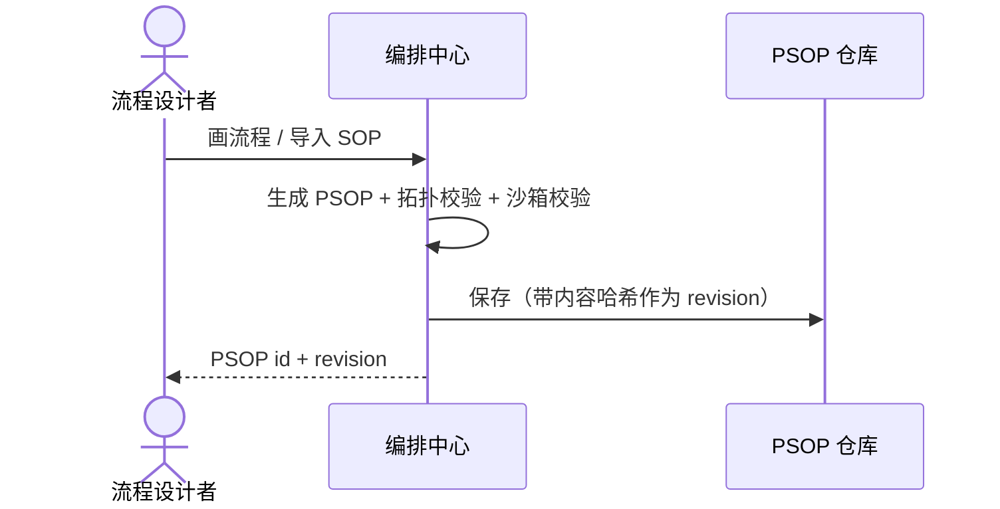
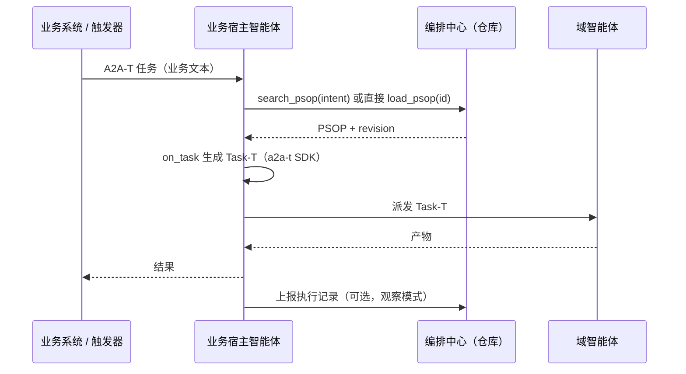
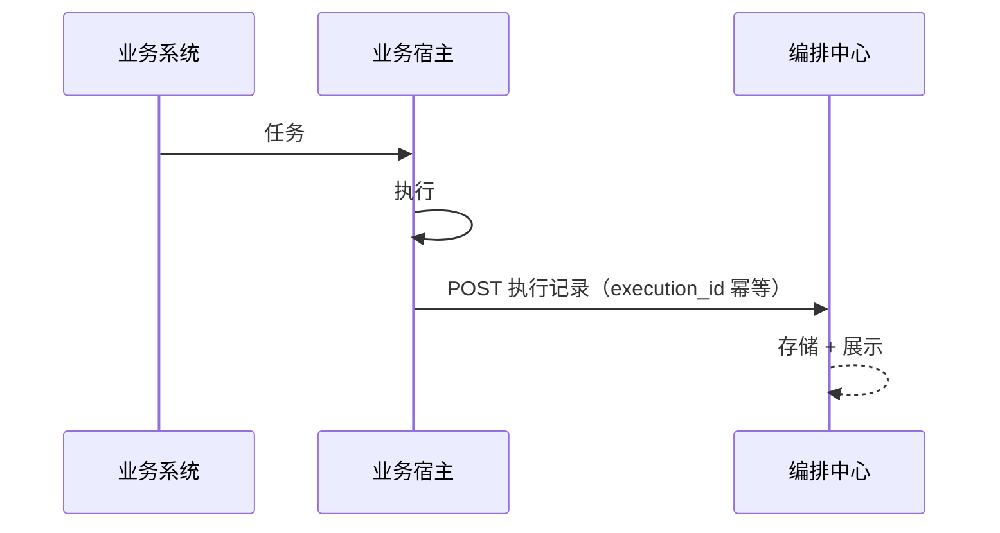

<!--
Copyright (c) 2026 Huawei Technologies Co., Ltd.
All Rights Reserved.

SPDX-License-Identifier: Apache-2.0

   Licensed under the Apache License, Version 2.0 (the "License"); you may
   not use this file except in compliance with the License. You may obtain
   a copy of the License at

        http://www.apache.org/licenses/LICENSE-2.0

   Unless required by applicable law or agreed to in writing, software
   distributed under the License is distributed on an "AS IS" BASIS, WITHOUT
   WARRANTIES OR CONDITIONS OF ANY KIND, either express or implied. See the
   License for the specific language governing permissions and limitations
   under the License.
-->

# 宿主与编排中心的职责边界

**状态:** Proposed（待评审）。本文描述目标边界与迁移路径，不代表当前已实现的行为。

**Revision anchors**（文中的 `file:line` 均按此基线阅读）：

| 仓库 | 版本 | 日期 |
|---|---|---|
| `project-openan/orchestration-center` | `b1fe54a` | 2026-10-20 |
| `project-openan/workflow-engine-sdk-python` | `0.1.1` | — |
| `project-openan/workflow-engine-sdk-java` | `workflow-engine` 模块 `LoadPsop` | — |

**触发背景:** orchestration-center issue #208（江苏移动现场）。工作流“执行成功”但执行中心无历史、无结果。客户附上的那条记录，是编排中心把 PSOP 派发给了域智能体而不是宿主；同一时段由中心派发给宿主的执行是正常的——两类记录混在同一个列表里，暴露的正是“谁来决定执行者”这条边界不清。

## 0. 摘要

一句话：**SDK 提供能力，业务宿主拥有执行，编排中心只做设计、存储与观察。**

当前实现把“选谁执行、检索哪个 PSOP、何时发起”从业务宿主挪到了编排中心，并用一个默认的 `Host Agent` 兜底。这偏离了 Java SDK 的模型（`WorkbenchOrchestrator` 自己 `LoadPsop.search` → `load` → 执行），并在现场表现为“派发给了 worker、记录显示成功、但没有执行任何步骤”。本文给出边界、判定规则、变更清单与验收标准。

## 1. 角色定义

| 角色 | 是什么 | 谁的代码 |
|---|---|---|
| **SDK** | 能力层：AgentCard 获取、PSOP 检索（`load_psop` / `search_psop`）、DAG 执行（`execute_psop` / `WorkflowExecutor`）、A2A-T 传输、`ControlPoint` 接口 | 我们 |
| **业务宿主智能体**（workbench / host） | 一次业务流程的执行所有者：决定用哪个 PSOP、何时发起、Task-T 如何生成、路由与汇总口径 | **客户**（我们只提供示例） |
| **域智能体**（worker） | 单一能力的 A2A-T 服务端：接收 Task-T，返回产物 | 客户 / 第三方 |
| **编排中心** | 设计时工具 + PSOP 仓库 + 执行观察者 | 我们 |
| **执行中心** | 编排中心里的一个 UI 功能，用于回放执行过程 | 我们 |
| **PSOP 快照** | 某一时刻的 PSOP 内容副本，用于锁定执行版本 | 产生方可变 |

注意区分两个“宿主”：`host_agent/` 包是**业务中立的执行外壳**（协议适配、生命周期、取消），业务策略通过注入的 `ControlPoint` 提供；`samples/spn_host_agent` 是一个**业务宿主示例**。当前示例被注册为 `Host Agent`，与外壳同名，这是混淆来源之一。

关于“默认 Host Agent 会不会接管业务智能体的操作”：它不会接管域智能体的技能（每个子任务仍按 PSOP 的 `agent` 字段发给对应智能体），但它持有三样本应属于业务宿主的东西——Task-T 内容、路由判定、汇总口径。这三样由示例实现并默认注册，才是“手伸得太长”的实际含义。产品侧的 `host_agent/` 外壳本身不含任何业务判断。

## 2. 设计原则

- **P1 能力与决策分离。** SDK 只提供能力，不内置默认宿主、默认路由、默认业务口径；`ControlPoint` 的每个方法都应被显式实现或被显式拒绝。
- **P2 执行所有权归业务宿主。** 谁的业务谁发起。业务系统把任务交给宿主，宿主自己检索 PSOP、自己派发域智能体、自己持有结果。
- **P3 观察不等于发起。** 编排中心可以展示执行过程，但展示不应以获得调度权为代价；中心的“一键执行”只是**一次普通的 A2A-T 调用**，与业务系统的调用等价，不是特殊通道。
- **P4 显式优于默认。** 任何“谁来执行”的决定必须来自配置或请求，不得 fallback 到某个名字或“列表第一张卡”。

## 3. 职责矩阵

`O` = 所有者（决定并负责），`E` = 执行，`R` = 只读参与，`—` = 禁止参与。

| 能力 | SDK | 业务宿主 | 域智能体 | 编排中心 |
|---|---|---|---|---|
| PSOP 设计 / 校验 | — | R | — | **O/E** |
| PSOP 存储与版本 | — | — | — | **O/E** |
| PSOP 检索（search） | E（API） | **O**（决定用哪个） | — | R（提供 API） |
| 选执行者 | — | **O** | — | R（只校验） |
| 发起执行 | E（Transport） | **O** | — | R（观察）或 O（仅显式代理模式） |
| Task-T 内容生成 | E（a2a-t） | **O/E** | — | — |
| 路由判定 / 汇总 | 接口（`ControlPoint`） | **O/E**（业务策略） | — | — |
| 执行记录写入 | — | **O/E**（发起方） | R（只上报自己的产物） | E（仅代理模式）或 R（观察模式） |
| 执行过程展示 | — | R | — | **O/E** |
| AgentCard / 注册 | E（`RegistryClient`） | E | E | R |

### 3.1 红线清单

**编排中心不得：**

1. 在目标未声明宿主能力时发起派发；不得用“默认名字”或“列表第一张卡”兜底。
2. 在观察模式下替业务宿主选择 PSOP；`center_proxy` 模式下也只允许“按调用方给出的 id 加载”，不得自行按 intent 挑选。
3. 在运行期修改已被引用的 PSOP；版本变更只能产生新 revision。
4. 持有业务宿主的凭证；调用宿主时使用调用方或服务自身的最小权限身份。

**业务宿主不得：**

5. 绕过 A2A-T 直接调用域智能体的私有接口。
6. 实现本属于域智能体的领域能力（诊断算法、数据采集）；宿主只做流程编排与业务方声明的汇总。
7. 把 Task-T 内容生成转嫁给域智能体（A2A-T 客户端职责）。

**域智能体不得：**

8. 反向调用编排中心的管理接口。

## 4. 现状与偏差

### 4.1 中心替宿主检索并下发快照

未指定 PSOP 时，中心按 intent 检索 top3 并加载完整快照下发给宿主（`orchestrate/runtime/exec_engine.py:98-124`、`:148-155`）。宿主侧 `_resolve_workflow` 把快照列为第一优先级（`host_agent/runtime.py:255-277`），按 ID 拉取退居第二，按 intent 检索退居第三（`:279-287`）。

结果是“中心选完告诉宿主执行”，与 Java 的“宿主 `search` 完自己 `load`”相反。

### 4.2 中心默认选执行者

- 原中心曾在未确定宿主时使用内置名称；当前宿主以 PSOP 本地步骤声明为准。
- 执行中心的智能体下拉先找名字含 `workbench` 的卡，**找不到就用第一张卡**（`workflow-designer/src/components/execution_center/index.jsx:556-560`）。

现场的三张卡里宿主叫 `Host Agent`、不含 `workbench`，于是默认选中了 `Core Network Fault Diagnosis Agent`（域智能体）。点“执行”后中心把 PSOP 快照发给 worker，worker 回了一条消息即结束，记录写成 `success` + 0 步骤。

### 4.3 示例业务宿主占用默认名，且宿主检索路径无凭证

`samples/start_agents_server.py:143-144` 把 SPN 业务宿主注册为 `Host Agent`；其业务内容（Task-T 生成、路由判定、自汇总）都在 `samples/spn_host_agent/`（`content.py:158`、`control_point.py:75`、`:87`）。

同时，宿主的检索适配器调用 `load_psop` / `search_psop` 时**没有传 `access_token`**（`host_agent/workflow_repository.py:32-48`），中心一旦启用外部鉴权，这条“宿主自主检索”的路就是 401。也就是说我们从未验证过 P2。

### 4.4 执行记录不存历史

记录在 SSE 的 `finally` 里写入，`execution_history` 恒为 `[]`（`orchestrate/server/sse_executor.py:235`），列表里的 `step_count` 永远是 0，时间线只能靠 `events` 重建。一旦事件本身为空（例如误派发），记录就是“成功但空白”。

## 5. 目标模型

### 5.1 设计时（中心主导）



中心是唯一能写 PSOP 的角色；导出能力只产出内容与 revision，不产出“该由谁执行”的结论。

### 5.2 生产运行时（业务宿主主导）



宿主决定检索方式（按 intent 还是按固定 id）、决定是否锁定 revision、决定派发顺序。中心不参与。

### 5.3 执行中心（两种合法模式）

**M1 观察模式（推荐）。** 中心只读：宿主在执行过程中或结束后把记录推给中心，中心做展示与检索。调用方仍是业务系统。协议细节（CloudEvents 上报）见 [执行过程观察：整体方案](execution-observation.md)。



**M2 显式代理启动（演示 / 运维排查）。** 中心以**显式指定的宿主**发起一次 A2A-T 调用，与业务系统的调用等价。要求：目标必填、必须声明宿主能力、不得有默认值。这条路径不代替业务系统，只在演示或排障时使用。

两种模式互斥配置，不允许“有时中心发起、有时宿主发起”的混合部署。

## 6. 宿主能力声明

新增一个可选的能力声明，供中心校验与前端筛选。建议用 AgentCard 的 skill 表达（无协议改动）：

```json
{
  "name": "spn-workbench-agent",
  "skills": [
    {
      "id": "workflow-host",
      "name": "Workflow Host",
      "description": "可以承接 PSOP 执行并派发域智能体",
      "tags": ["workflow-host"],
      "examples": ["执行跨城专线投诉诊断流程"]
    }
  ]
}
```

校验规则：

- 中心解析 `target_agent` 对应的卡片，若不存在 `workflow-host` skill / tag，返回 `400 TARGET_AGENT_NOT_A_HOST`，**不发起派发**；
- 前端下拉只列声明了该能力的卡片，默认值来自配置而不是 `cards[0]`；
- `/dispatch`（按 intent 直发宿主）走同一套校验。

## 7. 执行记录归属

单一事实源规则：**记录由发起方写入，中心只存副本。**

| 模式 | 写入方 | 中心角色 | 关键字段 |
|---|---|---|---|
| M1 观察 | 业务宿主 | 接收并展示 | `execution_id`（宿主生成，幂等）、`psop_id`、`psop_revision`、`host_agent`、`started_at`、`completed_at`、`status`、`steps[]`、`artifacts[]`、`error` |
| M2 代理 | 编排中心 | 写入并展示 | 同上 |

硬性要求：

1. `steps[]` 至少包含每个步骤的名称、状态、任务列表与每个任务的产物摘要；禁止“成功但 0 步骤”的记录——这种执行在写入前应判为 `failed`，错误码 `EXECUTION_NO_STEPS`。
2. 记录必须带 `psop_revision`（PSOP 内容哈希），用于回答“这次跑的是哪一版”。
3. 记录写入失败要显式返回错误，不能吞掉（参考 issue #208 的取证需求）。

## 8. 变更清单

以下变更全部落在 `orchestration-center` 仓库；SDK 无需改动（`load_psop` / `search_psop` 能力已具备），Java 端同样只改示例。

### 8.1 配置

| 键 | 现状 | 目标 |
|---|---|---|
| PSOP 本地步骤宿主 | 由 `SelfLoop.subtasks[].agent` 表达 | 中心派发按定义选择宿主，拒绝存在多个不同宿主的定义 |
| `execution.mode` | 无 | `observer`（默认）/ `center_proxy`，二选一 |
| `host.capability.required` | 无 | 默认 `true`，关闭仅用于兼容期 |

### 8.2 接口

| 接口 | 变更 |
|---|---|
| `GET /api/v1/orchestrate/execute/{psop_id}` | 保留；仅 `center_proxy` 模式可调用 |
| `GET /rest/v1/orchestrate/execute` | 按 PSOP 的本地步骤派发，历史流程可显式传 `target_agent` |
| `GET /rest/v1/orchestrate/dispatch` | 无宿主声明时，由请求提供宿主并检查对应卡片的能力 |
| 新增 `POST /rest/v1/orchestrate/execution-records` | 宿主上报记录，`execution_id` 幂等 upsert，仅接受声明了宿主能力的调用方 |

### 8.3 代码

| 位置 | 动作 |
|---|---|
| `orchestrate/runtime/exec_engine.py:61` | 去掉默认宿主名 |
| `orchestrate/runtime/exec_engine.py:98-124` | 中心侧 intent 检索仅在 `center_proxy` 模式启用 |
| `host_agent/workflow_repository.py:32-48` | 传入 `access_token` / `auth_provider` |
| `host_agent/runtime.py:255-287` | 快照支持保留，但降级为显式开关（`allow_snapshot`） |
| `orchestrate/server/sse_executor.py:235` | 从事件汇总 `execution_history` |
| `workflow-designer/.../execution_center/index.jsx:556-560` | 删除 `cards[0]` 兜底，只列宿主 |
| `samples/start_agents_server.py:143-144` | 示例改名 `spn-workbench-agent`，默认不注册 |

## 9. 迁移与兼容

1. **有宿主定义的流程**：根据已加载 `SelfLoop` 子任务的宿主名匹配注册卡片。
2. **历史无宿主定义的流程**：中心主动派发由调用方显式指定目标。
3. **执行中心**：默认切到 `observer`；`center_proxy` 需显式开启，并在 UI 上标注“演示/排障用途”。
4. **旧记录**：`execution_history` 为空的存量记录标记为 `legacy`，不做回填。

## 10. 验收标准

| # | 用例 | 期望 |
|---|---|---|
| A1 | 历史流程显式目标指向未声明宿主能力的卡片 | 返回错误，网络派发次数为零 |
| A2 | 检索到不同宿主的两个流程 | 各自派发到定义中的宿主，歧义时拒绝派发 |
| A3 | 宿主按 intent 自主检索并执行（中心不传快照） | 成功，记录 `steps` 非空 |
| A4 | 宿主执行 0 步骤（例如目标不是宿主） | 记录 `failed` + `EXECUTION_NO_STEPS`，列表可见 |
| A5 | 中心无默认宿主时打开执行中心 | 下拉为空并提示，不自动选中 |
| A6 | 宿主执行完毕后上报记录 | 中心按 `execution_id` 幂等存储，重复上报不产生重复行 |

## 11. 开放问题

1. **多宿主与租户隔离**：同一中心是否允许多个业务宿主并存（按业务域划分）？若允许，PSOP 需要归属标记，`target_agent` 由业务系统而非中心决定。
2. **记录存储位置**：观察模式下记录由宿主产生，中心是否长期保存全量 `events`（体积）还是只存摘要 + 指向宿主的引用？
3. **revision 的强制程度**：`psop_revision` 只记录不校验，还是宿主可指定 revision 并要求中心返回该版本（需要 PSOP 历史存储）？
4. **事件推送协议**：观察模式采用宿主 POST 上报、A2A-T 通知还是 webhook？三者的鉴权与重放语义不同。

## 12. 需要拍板

| # | 决策 | 建议 |
|---|---|---|
| D1 | 默认执行模式选 `observer` 还是 `center_proxy` | `observer`。代理启动只保留给演示与排障，并在 UI 上显式标注 |
| D2 | 宿主能力用 AgentCard skill 还是 A2A 扩展 URI 声明 | skill（`workflow-host`）。无需协议改动，现有卡片加载链路可直接读；将来需要更强语义再升级为扩展 |
| D3 | 执行记录的事实源放在宿主还是中心 | 宿主（发起方）；中心只存展示副本，按 `execution_id` 幂等 |

